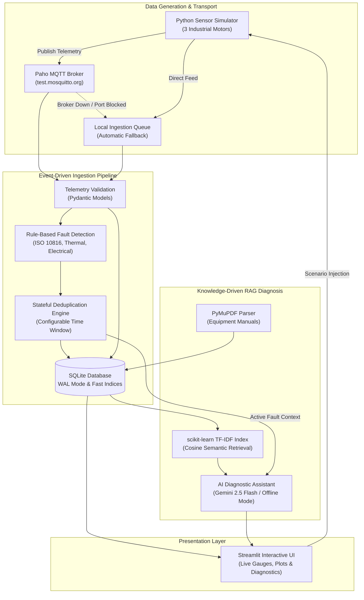

# P_311: Knowledge-Driven IoT Fault Diagnosis Assistant

An event-driven industrial IoT fault diagnosis and equipment health management system designed for industrial electric motors.

The platform continuously monitors physical telemetry streams, performs real-time rule-based anomaly detection, suppresses alert storms via intelligent deduplication, and provides knowledge-grounded root-cause analysis through technical equipment manuals using **PyMuPDF**, **scikit-learn TF-IDF**, and **Google Gemini API** (with a 100% offline local fallback mode).

---

## 🏗️ Architecture Overview



---

## 🏭 Monitored Industrial Motor Assets

The system ships with pre-configured baseline profiles and physical parameters for three distinct industrial electric motors:

| Device ID | Motor Asset Description | Application | Rated Power | Rated Current | Nominal RPM | Nominal Voltage | Baseline Pressure |
| :--- | :--- | :--- | :--- | :--- | :--- | :--- | :--- |
| `MOTOR-PUMP-01` | Centrifugal Water Pump Motor | Coolant circulation | 15.0 kW | 28.0 A | 1,450 RPM | 230 V | 4.2 bar |
| `MOTOR-CONV-02` | Heavy Incline Belt Conveyor | Raw material feed | 11.0 kW | 21.0 A | 1,470 RPM | 230 V | N/A |
| `MOTOR-COMP-03` | Rotary Twin-Screw Compressor | Plant pneumatic air | 22.0 kW | 41.0 A | 2,960 RPM | 230 V | 7.5 bar |

---

## ⚡ Configurable Fault Detection Rules

All rules feature configurable thresholds and automatic stateful deduplication:

1. **High Temperature Rule (`OVERHEATING`)**
   - **Warning:** Casing temperature $\ge 75.0^\circ\text{C}$
   - **Critical:** Casing temperature $\ge 90.0^\circ\text{C}$ (NEMA Class F insulation threshold)
2. **High Vibration Rule (`BEARING_WEAR`)**
   - **Warning:** Vibration velocity $\ge 4.5\text{ mm/s RMS}$ (ISO 10816 Zone C)
   - **Critical:** Vibration velocity $\ge 7.1\text{ mm/s RMS}$ (ISO 10816 Zone D)
3. **Overcurrent Rule (`ELECTRICAL_OVERLOAD`)**
   - **Warning:** Phase current $\ge 115\%$ of motor full-load amperes (FLA)
   - **Critical:** Phase current $\ge 135\%$ FLA (Locked rotor or mechanical jam)
4. **Voltage Sag Rule (`VOLTAGE_SAG`)**
   - **Warning:** Supply voltage $\le 207.0\text{ V}$ (-10% nominal)
   - **Critical:** Supply voltage $\le 195.0\text{ V}$ (-15% nominal)
5. **Acoustic Anomaly Rule (`ACOUSTIC_ANOMALY`)**
   - **Warning:** Acoustic noise $\ge 85.0\text{ dB}$
   - **Critical:** Acoustic noise $\ge 95.0\text{ dB}$
6. **Compound Bearing Seizure Rule (`COMPOUND_BEARING_FAILURE`)**
   - **Critical:** Vibration $\ge 5.5\text{ mm/s}$ **AND** Temperature $\ge 80.0^\circ\text{C}$ simultaneously.
7. **Pump Cavitation Rule (`PUMP_CAVITATION`)**
   - **Warning / Critical:** Acoustic noise $\ge 88\text{ dB}$ and discharge pressure drops below 3.0 bar.

---

## 🔄 Resilient MQTT & Local Fallback Mode

- **Configurable MQTT Broker**: Default configured to `test.mosquitto.org:1883`.
- **Automatic Reconnection**: Supports Paho MQTT v2/v1 with exponential backoff.
- **Zero-Failure Local Fallback**: When an MQTT broker cannot be reached (e.g. firewalled network, offline development, or port 1883 blocked), the application automatically routes telemetry through an in-memory queue and persists directly to SQLite without crashing or interrupting operations.

---

## 🧠 Knowledge-Driven RAG Diagnosis (Online & Offline)

1. **PyMuPDF Document Ingestion**:
   - Parses industrial maintenance PDFs, user manuals, and technical standards.
   - Bootstraps a comprehensive standard equipment guide covering thermal limits, ISO 10816 criteria, electrical diagnostics, and cavitation on first launch.
2. **scikit-learn TF-IDF Vector Retrieval**:
   - Builds an in-memory TF-IDF index across all document chunks.
   - Computes cosine similarity to find the most relevant manual sections for any active fault or operator query.
3. **Hybrid AI Engine**:
   - **With `GEMINI_API_KEY`**: Generates grounded root-cause analysis, safety precautions, and maintenance procedures using Gemini 2.5 Flash.
   - **Without API Key (Offline Fallback)**: Automatically activates the deterministic local synthesis engine that extracts relevant manual sections, safety directives (LOTO, etc.), and maintenance checklists directly from the indexed manual.

---

## 🚀 Quickstart Guide

### 1. Prerequisites & Environment Setup

```bash
# Clone and enter the repository
cd /path/to/HCL_Event_Driven_Fault_Analysis

# Create and activate virtual environment
python3 -m venv .venv
source .venv/bin/activate

# Install dependencies
pip install -r requirements.txt
```

### 2. Configuration (.env)

Copy the sample environment file:
```bash
cp .env.example .env
```

*(Optional)* Add your Gemini API key to `.env` if desired:
```env
GEMINI_API_KEY=your_gemini_api_key_here
```

### 3. Run Test Suite

```bash
pytest -v
```

### 4. Launch Application

```bash
streamlit run app.py
```

Access the dashboard at `http://localhost:8501`.

---

## 🖥️ Polished 5-Page Industrial Monitoring Dashboard

The user interface is structured across five dedicated operational pages styled in a dark industrial theme:

1. **🏭 Overview**:
   - High-level plant health overview and fleet operational score (0–100%).
   - Monitored motor asset summary cards with health badges (`OPERATIONAL`, `WARNING`, `CRITICAL`, `STANDBY`).
   - Latest sensor snapshot metrics, active alarm counts, and master simulation controls.
2. **📊 Live Monitoring**:
   - Device selector across all three motors (`MOTOR-PUMP-01`, `MOTOR-CONV-02`, `MOTOR-COMP-03`).
   - Plotly dark-themed interactive engineering waveforms:
     - **Temperature (°C)** with Warning ($75^\circ\text{C}$) and Critical ($90^\circ\text{C}$) threshold lines.
     - **Vibration Velocity (mm/s RMS)** with ISO 10816 Zone C ($4.5\text{ mm/s}$) and Zone D ($7.1\text{ mm/s}$) criteria.
     - **Shaft Speed (RPM)** time-series with nominal speed reference.
     - **Phase Current (A RMS)** with rated full-load current (FLA) markers.
   - Dynamic fault injection panel to trigger operational degradation scenarios in real time.
3. **🚨 Fault Management**:
   - Live anomaly queue displaying severity badges, occurrence count deduplication, and triggering metrics.
   - Fault acknowledgement and resolution workflows with **Technician Name** and **Maintenance Notes** inputs saved to SQLite.
   - Historical incident logs and technician maintenance activity records.
4. **🤖 AI Diagnosis**:
   - **Automated Root-Cause Diagnostic Service**: Validated structured JSON containing fault title, severity, empirical observations, grounded possible causes, recommended actions (OSHA LOTO), evidence, verifiable document source citations, and qualified confidence rating.
   - **Conversational Troubleshooting Assistant**: Multi-turn RAG chat citing verified manual passages, document names, and page numbers.
   - Transparent engine identification: explicitly indicates `Google Gemini (model)` or `Deterministic Demo Fallback (Offline Mode)` with failure reasons.
5. **📚 Knowledge Base**:
   - PyMuPDF PDF manual upload with page count, chunk count, file size, and SHA256 integrity hash.
   - Document listing with chunk inspection expanders and complete document deletion (atomic SQLite and TF-IDF index purge).
   - Interactive TF-IDF semantic retrieval tester with cosine similarity ranking.

---

## 📁 Repository Structure

```
HCL_Event_Driven_Fault_Analysis/
├── .env.example              # Sample environment configuration
├── .gitignore                # Git ignore specifications
├── requirements.txt          # Python dependency specifications
├── README.md                 # Complete system documentation
├── config.py                 # Centralized configuration dataclasses
├── app.py                    # Streamlit 5-page entrypoint application
├── data/
│   ├── manuals/              # Technical manuals (auto-bootstrapped PDF)
│   └── iot_fault_diagnosis.db# SQLite database
├── src/
│   ├── models/
│   │   ├── telemetry.py      # Telemetry and FaultEvent Pydantic schemas
│   │   └── diagnosis.py      # StructuredFaultDiagnosis & ChatMessage schemas
│   ├── database/
│   │   └── db_manager.py     # SQLite persistence with WAL mode & metadata
│   ├── fault_detection/
│   │   ├── rules.py          # ISO 10816, thermal, and electrical rules
│   │   └── detector.py       # Deduplicating fault engine
│   ├── mqtt/
│   │   └── mqtt_client.py    # Resilient Paho MQTT client & local fallback
│   ├── simulator/
│   │   └── motor_simulator.py# 3-motor sensor simulator & scenario injector
│   ├── knowledge/
│   │   ├── pdf_processor.py  # PyMuPDF manual extraction & metadata hashing
│   │   ├── tfidf_index.py    # scikit-learn TF-IDF cosine retrieval
│   │   └── ai_assistant.py   # Gemini API RAG with offline deterministic fallback
│   ├── services.py           # Long-lived singleton service container
│   └── ui/
│       ├── theme.py          # Dark industrial CSS and Plotly dark styling
│       ├── overview_view.py  # Page 1: Plant overview & fleet health summary
│       ├── monitoring_view.py# Page 2: Live Plotly waveforms & scenario injector
│       ├── fault_view.py     # Page 3: Fault queue, resolution & maintenance logs
│       ├── diagnosis_view.py # Page 4: Root-cause diagnosis & RAG chat assistant
│       └── knowledge_view.py # Page 5: PDF upload, indexing, listing & deletion
└── tests/
    ├── test_models.py        # Telemetry validation tests
    ├── test_database.py      # SQLite persistence and deduplication tests
    ├── test_fault_detector.py# Rule evaluation and deduplication tests
    ├── test_simulator.py     # 3-motor generation and scenario tests
    ├── test_mqtt_and_fallback.py # MQTT and offline fallback tests
    └── test_knowledge.py     # PyMuPDF, TF-IDF and offline diagnosis tests
```
