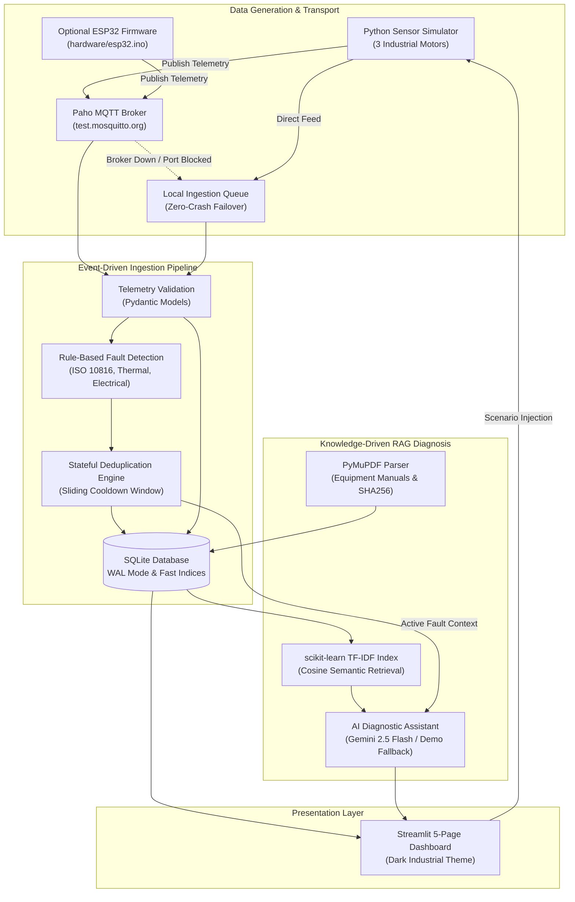

# P_311: Knowledge-Driven IoT Fault Diagnosis Assistant

[](https://www.python.org/)
[](https://streamlit.io/)
[](https://eclipse.dev/paho/)
[](https://sqlite.org/)
[](https://pymupdf.readthedocs.io/)
[](https://ai.google.dev/)
[](file:///home/divy547/Projects/HCL_Event_Driven_Fault_Analysis/tests/)

An event-driven industrial IoT fault diagnosis and equipment health management system designed for industrial electric motors.

The platform continuously monitors physical multi-sensor telemetry, performs real-time rule-based anomaly detection, suppresses alert storms via intelligent deduplication, and provides knowledge-grounded root-cause analysis through technical equipment manuals using **PyMuPDF**, **scikit-learn TF-IDF**, and the **Google Gemini API** (with a 100% offline local fallback mode).

> [!NOTE]
> **No Paid Services or Paid Hardware Mandatory:** The application operates completely out of the box in **Demo Mode** without physical sensors, cloud brokers, or a Gemini API key. All features, charts, rules, and RAG diagnostics run locally.

---

## 🏗️ System Architecture



For complete architectural details, see the [Technical Architecture Documentation](file:///home/divy547/Projects/HCL_Event_Driven_Fault_Analysis/docs/architecture.md) and [Engineering Project Report](file:///home/divy547/Projects/HCL_Event_Driven_Fault_Analysis/docs/project_report.md).

---

## 🏭 Monitored Industrial Motor Assets

The platform monitors three distinct industrial electric motors with physical baselines and degradation profiles:

| Device ID | Asset Name & Application | Rated Power | Rated Current | Nominal Speed | Baseline Pressure |
| :--- | :--- | :--- | :--- | :--- | :--- |
| `MOTOR-PUMP-01` | Centrifugal Coolant Pump Motor | 15.0 kW | 28.0 A | 1,450 RPM | 4.2 bar |
| `MOTOR-CONV-02` | Heavy Raw Material Incline Conveyor | 11.0 kW | 21.0 A | 1,470 RPM | N/A |
| `MOTOR-COMP-03` | Rotary Twin-Screw Air Compressor | 22.0 kW | 41.0 A | 2,960 RPM | 7.5 bar |

---

## ⚡ Configurable Fault Detection Rules

All rules feature configurable thresholds and automatic stateful deduplication:

1. **High Temperature Rule (`OVERHEATING`)**
   - **Warning:** Casing temperature $\ge 75.0^\circ\text{C}$
   - **Critical:** Casing temperature $\ge 90.0^\circ\text{C}$ (NEMA Class F insulation threshold)
2. **High Vibration Rule (`BEARING_WEAR`)**
   - **Warning:** Vibration velocity $\ge 4.5\text{ mm/s RMS}$ (ISO 10816 Zone C)
   - **Critical:** Vibration velocity $\ge 7.1\text{ mm/s RMS}$ (ISO 10816 Zone D)
3. **Overcurrent Rule (`ELECTRICAL_OVERLOAD`)**
   - **Warning:** Phase current $\ge 115\%$ of motor full-load amperes (FLA)
   - **Critical:** Phase current $\ge 135\%$ FLA (Mechanical jam or locked rotor)
4. **Voltage Sag Rule (`VOLTAGE_SAG`)**
   - **Warning:** Supply voltage $\le 207.0\text{ V}$ (-10% nominal)
   - **Critical:** Supply voltage $\le 195.0\text{ V}$ (-15% nominal)
5. **Acoustic Anomaly Rule (`ACOUSTIC_ANOMALY`)**
   - **Warning:** Acoustic noise $\ge 85.0\text{ dB}$
   - **Critical:** Acoustic noise $\ge 95.0\text{ dB}$
6. **Compound Bearing Seizure Rule (`COMPOUND_BEARING_FAILURE`)**
   - **Critical:** Vibration $\ge 5.5\text{ mm/s}$ **AND** Temperature $\ge 80.0^\circ\text{C}$ simultaneously.
7. **Pump Cavitation Rule (`PUMP_CAVITATION`)**
   - **Warning / Critical:** Acoustic noise $\ge 88\text{ dB}$ and discharge pressure drops below 3.0 bar.

---

## 🖥️ Polished 5-Page Industrial Monitoring Dashboard

Styled with a consistent **Dark Industrial Theme** (`#0b0e14`, `#12171f`, `#151b23`):

1. **🏭 Overview**: Fleet Health Index (0–100%), asset status badges (`OPERATIONAL`, `WARNING`, `CRITICAL`, `STANDBY`), real-time sensor snapshots, simulator master controls, and live alarm feed.
2. **📊 Live Monitoring**: Device filter across all three motors, sample depth selector (30, 60, 100, 200 samples), latest gauge cards with baseline deltas, and four **Plotly dark-themed interactive engineering waveforms**:
   - **Temperature (°C)** with Warning ($75^\circ\text{C}$) and Critical ($90^\circ\text{C}$) lines.
   - **Vibration Velocity (mm/s RMS)** annotated with ISO 10816 Zone C ($4.5\text{ mm/s}$) and Zone D ($7.1\text{ mm/s}$) criteria.
   - **Shaft Speed (RPM)** tracking rotational slip.
   - **Phase Current (A RMS)** with rated full-load current (FLA) markers.
   - **Dynamic Fault Injection Panel** to trigger individual degradation scenarios in real time.
3. **🚨 Fault Management**: Live incident queue with severity badges, occurrence count deduplication ($N\text{x}$ within window), acknowledgement button, and resolution workflow with **Technician Name** and **Maintenance Notes** inputs saved to SQLite. Historical incident and maintenance activity logs.
4. **🤖 AI Diagnosis**:
   - **Automated Root-Cause Diagnostic Service**: Validated structured JSON containing fault title, severity, empirical observations, grounded possible causes, recommended actions (OSHA LOTO prioritized), technical evidence, verifiable document source citations, and qualified confidence score with engineering rationale.
   - **Conversational Troubleshooting Assistant**: Multi-turn RAG chat citing verified manual passages, document names, and page numbers.
   - Transparent engine identification: explicitly indicates `Google Gemini (model)` or `Deterministic Demo Fallback (Offline Mode)` with failure reasons.
5. **📚 Knowledge Base**: PDF manual upload with PyMuPDF text extraction, chunking, and SHA256 integrity hashing. Document listing with chunk inspection expanders, complete document deletion (atomic SQLite and TF-IDF index purge), and interactive TF-IDF semantic retrieval tester.

---

## 🚀 Setup & Installation Guide

### Option A: Linux & WSL2 (Recommended)

1. **Clone or enter the repository directory:**
   ```bash
   cd /home/divy547/Projects/HCL_Event_Driven_Fault_Analysis
   ```

2. **Create and activate a Python 3.12 virtual environment:**
   ```bash
   python3 -m venv .venv
   source .venv/bin/activate
   ```

3. **Install dependencies:**
   ```bash
   pip install --upgrade pip
   pip install -r requirements.txt
   ```

4. **Prepare environment configuration:**
   ```bash
   cp .env.example .env
   ```

---

### Option B: Windows (Native PowerShell / Command Prompt)

1. **Open PowerShell as Administrator** and navigate to the project directory:
   ```powershell
   cd C:\path\to\HCL_Event_Driven_Fault_Analysis
   ```

2. **Create and activate virtual environment:**
   ```powershell
   python -m venv .venv
   .venv\Scripts\Activate.ps1
   ```
   *(If script execution is blocked on Windows, run `Set-ExecutionPolicy -Scope Process -ExecutionPolicy Bypass` first).*

3. **Install dependencies:**
   ```powershell
   python -m pip install --upgrade pip
   pip install -r requirements.txt
   ```

4. **Copy environment template:**
   ```powershell
   copy .env.example .env
   ```

---

## ⚙️ Configuration & Environment Variables

Edit `.env` (or configure in the dashboard settings tab):

```ini
# MQTT Broker Configuration
# Default public test broker; automatically falls back to local queue if unreachable
MQTT_BROKER=test.mosquitto.org
MQTT_PORT=1883
MQTT_CLIENT_ID=p311_iot_assistant
MQTT_TELEMETRY_TOPIC=p311/industrial/telemetry
MQTT_ENABLED=true
MQTT_USE_FALLBACK_IF_UNAVAILABLE=true

# Database Persistence
DB_PATH=data/iot_fault_diagnosis.db

# Fault Detection Thresholds
FAULT_DEDUPLICATION_WINDOW_SEC=60.0
TEMP_WARNING_THRESHOLD=75.0
TEMP_CRITICAL_THRESHOLD=90.0
VIBRATION_WARNING_THRESHOLD=4.5
VIBRATION_CRITICAL_THRESHOLD=7.1
VOLTAGE_LOW_WARNING=207.0
VOLTAGE_LOW_CRITICAL=195.0
ACOUSTIC_WARNING_THRESHOLD=85.0
ACOUSTIC_CRITICAL_THRESHOLD=95.0

# Sensor Simulator Settings
SIMULATOR_INTERVAL_SEC=2.0
SIMULATOR_AUTO_START=false

# Google Gemini API (Optional - free tier Flash model)
# Leave empty for 100% offline deterministic demo mode!
GEMINI_API_KEY=
GEMINI_MODEL=gemini-2.5-flash
```

---

## 🏃 Running the Application

### 1. Run Automated Test Suite
Verify that all 28 unit and integration tests pass:
```bash
pytest -v
```

### 2. Launch the Streamlit Industrial Dashboard
```bash
streamlit run app.py
```
Open your browser at `http://localhost:8501`.

### 3. (Optional) Run the Standalone Simulator CLI
To run the sensor simulator independently in a terminal:
```bash
python -m src.simulator.motor_simulator
```

---

## 🔌 Physical Hardware Setup (Optional ESP32 Microcontroller)

The project includes optional Arduino C++ firmware in [`hardware/esp32.ino`](file:///home/divy547/Projects/HCL_Event_Driven_Fault_Analysis/hardware/esp32.ino) to stream live telemetry from physical microcontrollers:

### Hardware Requirements
- **Microcontroller:** ESP32 Dev Module / ESP32-WROOM-32.
- **Sensors (Optional):**
  - Temperature: LM35 / DS18B20 analog input on GPIO 34.
  - Vibration: Piezoelectric transducer / accelerometer on GPIO 35.
  - Current: ACS712 current transducer on GPIO 32.
  - *Note: If pins are unconnected, firmware automatically synthesizes realistic sensor physics!*

### Arduino IDE Setup
1. Install the **ESP32 Board Package** in Arduino IDE (`Boards Manager` -> search `esp32`).
2. Install required libraries from `Library Manager`:
   - `PubSubClient` by Nick O'Leary
   - `ArduinoJson` (v6 or v7) by Benoit Blanchon
3. Open [`hardware/esp32.ino`](file:///home/divy547/Projects/HCL_Event_Driven_Fault_Analysis/hardware/esp32.ino) and update your Wi-Fi credentials:
   ```cpp
   const char* WIFI_SSID     = "Your_WiFi_SSID";
   const char* WIFI_PASSWORD = "Your_WiFi_Password";
   const char* MQTT_BROKER   = "test.mosquitto.org"; // or your workstation IP
   const char* DEVICE_ID     = "MOTOR-PUMP-01";
   ```
4. Select `ESP32 Dev Module` and click **Upload**.
5. Open Serial Monitor at **115200 baud** to observe real-time MQTT packet emission.

---

## 🎯 Step-by-Step Evaluation & Demo Script

Follow this script to demonstrate all features:

1. **Launch Dashboard:**
   Start the app with `streamlit run app.py`. On the sidebar, click **▶️ Start** or **⚡ Quick Tick** under the simulator controls.
2. **Inspect Plant Overview (Page 1):**
   Observe the **Fleet Health Index (100%)**, three motor asset cards, and baseline physical telemetry.
3. **Inject Fault Anomaly (Page 2 - Live Monitoring):**
   Navigate to **Live Monitoring**. Scroll down to the **Dynamic Fault Injection Panel**:
   - Target Equipment: `MOTOR-PUMP-01`
   - Inject Scenario: `OVERHEATING`
   - Click **🔥 Inject Scenario**.
   - Observe the **Temperature Plotly waveform** climbing past the $75^\circ\text{C}$ warning line and reaching the $90^\circ\text{C}$ critical line.
4. **Inspect Stateful Deduplication (Page 3 - Fault Management):**
   Navigate to **Fault Management**.
   - Notice that continuous incoming telemetry did not create 100 duplicate database rows; the `occurrence_count` increments ($1\text{x}, 2\text{x}, 3\text{x}\dots$) with updated `last_detected` timestamps.
   - Click **👁️ Acknowledge** on the alert.
5. **Generate Knowledge-Driven AI Diagnosis (Page 4 - AI Diagnosis):**
   - Click **🤖 AI Diagnosis** next to the active fault.
   - Review the structured diagnostic report:
     - **Title:** `Thermal Overheating & Insulation Degradation on MOTOR-PUMP-01`
     - **Confidence Rating:** `HIGH (88%)` with engineering justification.
     - **Observations & Evidence:** Specific sensor values exceeding limits.
     - **Grounded Possible Causes & Actions:** Ventilation fan cowl cleaning and OSHA LOTO directives.
     - **Verifiable Document Sources:** Citations from `sample_industrial_motor_manual.pdf` with exact page numbers.
   - Switch to the **Conversational Troubleshooting Assistant** sub-tab and click the quick prompt: `🔥 Class F Thermal Limits`.
6. **Resolve Incident with Maintenance Notes (Page 3):**
   Return to **Fault Management**. Expand **🛠️ Resolve Incident**:
   - Technician Name: `Lead Reliability Engineer`
   - Notes: `Cleaned fan shroud and purged grease port per manual Section 1.2`
   - Click **Mark Resolved**.
   - Switch to the **Technician Maintenance Records** tab to verify the persistent audit log.
7. **Document Ingestion & Deletion (Page 5 - Knowledge Base):**
   - Review indexed documentation metadata (pages, chunks, SHA-256 hash).
   - Test a query in the **TF-IDF Semantic Retrieval Tester**: `ISO 10816 Zone D critical vibration limit`.
   - Click **🗑️ Delete Manual** to test atomic SQLite and vector index deletion, then click **Re-bootstrap** to restore it.

---

## 🔧 Troubleshooting Guide

| Issue | Root Cause | Solution |
| :--- | :--- | :--- |
| **MQTT status shows "Local Fallback Mode"** | Port 1883 outbound is blocked by enterprise firewall or `test.mosquitto.org` is unreachable. | **No action required.** The system automatically activates the zero-crash local queue fallback. Telemetry ingestion, rule detection, and database persistence continue normally. |
| **"No module named 'streamlit'" or library error** | Virtual environment is not activated. | Run `source .venv/bin/activate` (Linux/WSL) or `.venv\Scripts\Activate.ps1` (Windows) before running commands. |
| **"Gemini API key is not configured" notification** | No `GEMINI_API_KEY` was provided in `.env`. | **Normal behavior.** The system activates the local deterministic synthesis engine, producing the exact structured JSON schema citing the technical manuals without needing an API key. |
| **Database file locked (`OperationalError: database is locked`)** | Concurrent external process blocking SQLite. | The database uses `PRAGMA journal_mode=WAL` with automatic 15-second busy timeouts. Restart the app if an orphaned thread holds a lock. |

---

## 📁 Repository Structure

```
HCL_Event_Driven_Fault_Analysis/
├── .env.example              # Sample environment configuration
├── .gitignore                # Git ignore specifications
├── requirements.txt          # Python dependency specifications
├── README.md                 # Complete system documentation
├── config.py                 # Centralized configuration dataclasses
├── app.py                    # Streamlit 5-page entrypoint application
├── data/
│   ├── manuals/              # Technical manuals (auto-bootstrapped PDF)
│   └── iot_fault_diagnosis.db# SQLite database (WAL mode)
├── docs/
│   ├── architecture.md       # Mermaid system architecture documentation
│   └── project_report.md     # Engineering project technical report
├── hardware/
│   └── esp32.ino             # Optional ESP32 Arduino edge firmware
├── src/
│   ├── models/
│   │   ├── telemetry.py      # Telemetry & FaultEvent Pydantic schemas
│   │   └── diagnosis.py      # StructuredFaultDiagnosis & ChatMessage schemas
│   ├── database/
│   │   └── db_manager.py     # SQLite persistence with WAL mode & metadata
│   ├── fault_detection/
│   │   ├── rules.py          # ISO 10816, thermal, and electrical rules
│   │   └── detector.py       # Deduplicating fault engine
│   ├── mqtt/
│   │   └── mqtt_client.py    # Resilient Paho MQTT client & local fallback
│   ├── simulator/
│   │   └── motor_simulator.py# 3-motor sensor simulator & scenario injector
│   ├── knowledge/
│   │   ├── pdf_processor.py  # PyMuPDF manual extraction & metadata hashing
│   │   ├── tfidf_index.py    # scikit-learn TF-IDF cosine retrieval
│   │   └── ai_assistant.py   # Gemini API RAG with offline deterministic fallback
│   ├── services.py           # Long-lived singleton service container
│   └── ui/
│       ├── theme.py          # Dark industrial CSS and Plotly dark styling
│       ├── overview_view.py  # Page 1: Plant overview & fleet health summary
│       ├── monitoring_view.py# Page 2: Live Plotly waveforms & scenario injector
│       ├── fault_view.py     # Page 3: Fault queue, resolution & maintenance logs
│       ├── diagnosis_view.py # Page 4: Root-cause diagnosis & RAG chat assistant
│       └── knowledge_view.py # Page 5: PDF upload, indexing, listing & deletion
└── tests/
    ├── test_models.py        # Telemetry validation tests
    ├── test_database.py      # SQLite persistence and deduplication tests
    ├── test_fault_detector.py# Rule evaluation and deduplication tests
    ├── test_simulator.py     # 3-motor generation and scenario tests
    ├── test_mqtt_and_fallback.py # MQTT and offline fallback tests
    ├── test_knowledge.py     # PyMuPDF, TF-IDF and offline diagnosis tests
    └── test_validation_and_deduplication.py # Threshold & RAG validation tests
```

---

## 📄 License & Attribution

Developed under the **P_311: Knowledge-Driven IoT Fault Diagnosis Assistant** initiative. Built for industrial reliability engineering, condition-based monitoring (CBM), and predictive maintenance research.
