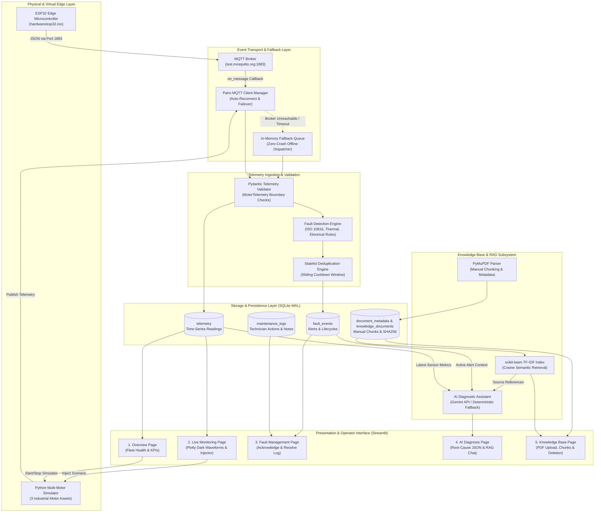
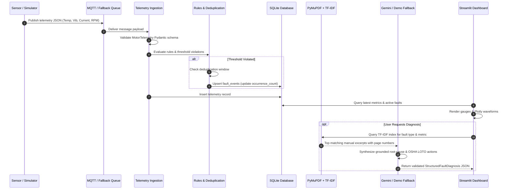
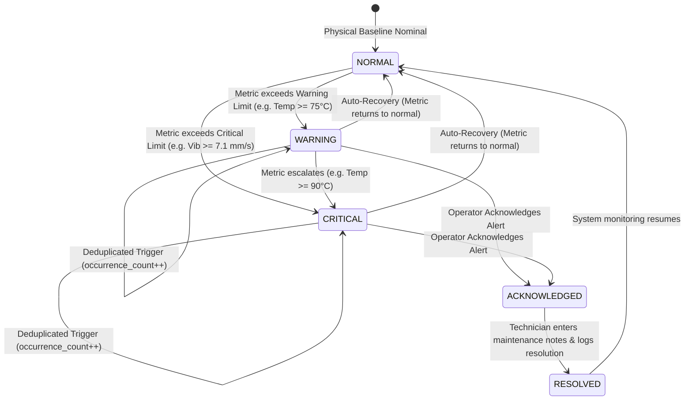

# P_311: Knowledge-Driven IoT Fault Diagnosis Assistant — Technical Architecture

This document provides the end-to-end technical architecture, component specifications, and operational flows of **P_311: Knowledge-Driven IoT Fault Diagnosis Assistant**.

---

## 1. High-Level System Architecture

---

## 2. Component Subsystems Breakdown

### 2.1 Edge Data Generation & Emulation
- **Multi-Motor Python Simulator ([`src/simulator/motor_simulator.py`](file:///home/divy547/Projects/HCL_Event_Driven_Fault_Analysis/src/simulator/motor_simulator.py))**:
  - Emulates 3 distinct industrial motor assets:
    1. `MOTOR-PUMP-01`: Centrifugal Water Pump (15 kW, 28A FLA, 1450 RPM, 4.2 bar).
    2. `MOTOR-CONV-02`: Incline Belt Conveyor (11 kW, 21A FLA, 1470 RPM).
    3. `MOTOR-COMP-03`: Rotary Screw Compressor (22 kW, 41A FLA, 2960 RPM, 7.5 bar).
  - Dynamically synthesizes Gaussian physical noise and injects operational degradation scenarios: `NORMAL`, `OVERHEATING`, `BEARING_WEAR`, `ELECTRICAL_OVERLOAD`, `VOLTAGE_SAG`, `COMPOUND_FAILURE`, and `CAVITATION`.
- **Optional ESP32 Microcontroller Firmware ([`hardware/esp32.ino`](file:///home/divy547/Projects/HCL_Event_Driven_Fault_Analysis/hardware/esp32.ino))**:
  - Runs on ESP32 Dev Modules using `WiFi.h`, `PubSubClient`, and `ArduinoJson`.
  - Publishes the exact telemetry JSON schema over Wi-Fi to `p311/industrial/telemetry/<device_id>`.

---

### 2.2 Transport & Failover Architecture
- **Paho MQTT Client Manager ([`src/mqtt/mqtt_client.py`](file:///home/divy547/Projects/HCL_Event_Driven_Fault_Analysis/src/mqtt/mqtt_client.py))**:
  - Connects asynchronously with exponential backoff to `test.mosquitto.org:1883` (or user-configured broker).
  - **Local Fallback Mode**: If the MQTT broker is down or enterprise firewall blocks port 1883, the client seamlessly routes messages through an in-memory queue (`queue.Queue`) directly into the ingestion pipeline, ensuring zero crashes and full continuous operation.

---

### 2.3 Event-Driven Rule Detection & Stateful Deduplication
- **Engineering Rule Pipeline ([`src/fault_detection/rules.py`](file:///home/divy547/Projects/HCL_Event_Driven_Fault_Analysis/src/fault_detection/rules.py))**:
  - **High Temperature**: Evaluates against NEMA Class F limits (Warning: $\ge 75^\circ\text{C}$, Critical: $\ge 90^\circ\text{C}$).
  - **ISO 10816 Vibration**: Evaluates overall velocity RMS against ISO machinery limits (Zone C Warning: $\ge 4.5\text{ mm/s}$, Zone D Critical: $\ge 7.1\text{ mm/s}$).
  - **Overcurrent**: Evaluates phase current against motor full-load amperes ($\ge 115\%$ Warning, $\ge 135\%$ Critical).
  - **Voltage Sag**: Detects bus under-voltage ($\le 207\text{ V}$ Warning, $\le 195\text{ V}$ Critical).
  - **Compound Bearing Seizure**: Detects simultaneous vibration ($\ge 5.5\text{ mm/s}$) and temperature ($\ge 80^\circ\text{C}$).
- **Stateful Deduplication Engine ([`src/fault_detection/detector.py`](file:///home/divy547/Projects/HCL_Event_Driven_Fault_Analysis/src/fault_detection/detector.py))**:
  - Tracks active alerts using key `(device_id, fault_type)`.
  - Telemetry received within the cooldown window (default 60 seconds) increments `occurrence_count` and updates `last_detected` and `metric_value` without duplicate database rows.
  - Automatically upgrades alert severity from `WARNING` to `CRITICAL` if the condition worsens.
  - Automatically resolves alerts when metrics return to normal range.

---

### 2.4 Knowledge-Driven RAG & AI Diagnostic Engine
- **PyMuPDF Document Ingestion ([`src/knowledge/pdf_processor.py`](file:///home/divy547/Projects/HCL_Event_Driven_Fault_Analysis/src/knowledge/pdf_processor.py))**:
  - Parses industrial PDF manuals into paragraph chunks with overlap.
  - Computes file size, page count, and SHA256 integrity hashes.
- **scikit-learn TF-IDF Semantic Search ([`src/knowledge/tfidf_index.py`](file:///home/divy547/Projects/HCL_Event_Driven_Fault_Analysis/src/knowledge/tfidf_index.py))**:
  - In-memory vector index with sublinear TF and cosine similarity.
  - Generates verifiable `DocumentSourceReference` citations (document name, page number, chunk ID, text excerpt, and similarity score).
- **Google Gemini API & Deterministic Fallback ([`src/knowledge/ai_assistant.py`](file:///home/divy547/Projects/HCL_Event_Driven_Fault_Analysis/src/knowledge/ai_assistant.py))**:
  - Uses `google.genai.Client` with configurable `GEMINI_MODEL` (default: `gemini-2.5-flash`).
  - Strict compliance: **Never fabricates sources**; claims are marked `is_verified=False` until physical field inspection.
  - **Deterministic Demo Fallback**: When offline or unauthenticated, activates a local synthesis engine that produces the identical structured schema grounded in the manual excerpts, explicitly reporting the fallback reason.

---

### 2.5 Storage Layer
- **SQLite Database Manager ([`src/database/db_manager.py`](file:///home/divy547/Projects/HCL_Event_Driven_Fault_Analysis/src/database/db_manager.py))**:
  - Configured with `PRAGMA journal_mode=WAL` and `PRAGMA synchronous=NORMAL` for concurrent readers and thread safety.
  - Tables:
    - `telemetry`: High-frequency sensor time-series records.
    - `fault_events`: Deduplicated alert lifecycle states.
    - `document_metadata`: Indexed PDF document catalog and SHA256 checksums.
    - `knowledge_documents`: Individual text chunks with page numbers.
    - `maintenance_logs`: Technician corrective interventions and notes.

---

## 3. Telemetry Ingestion & Diagnosis Sequence

---

## 4. Fault Incident Lifecycle State Machine

